# Shape of War player guide

Describes main at 13b7d96a1a067c61bfbaf8887fa96eb4dde807c2 (version v2 untagged), written 2026-10-29.

## Changed in this version

First edition.

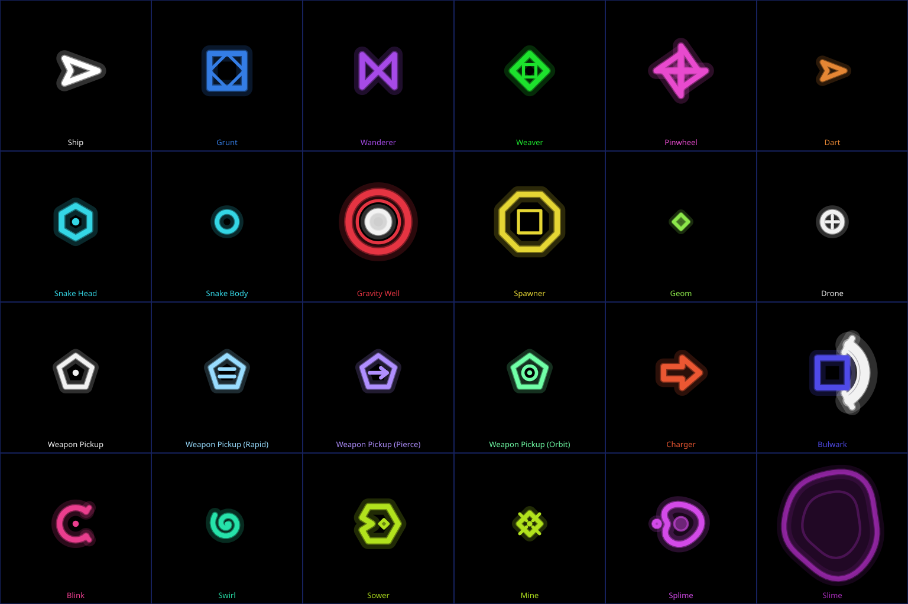

Items marked (v2) arrived after tag v1.1.0. Distances are in arena units (u). The arena is always shown whole, so 1 u is a fixed share of the screen for a given arena. Your ship's hitbox has a radius of 10 u.

## 1. Quick start

- **Goal.** Each Adventure level has one objective: score a target in a time limit, survive a time, or destroy a number of enemies. Endless has no objective: survive as long as you can.
- **Left thumb moves.** Put your thumb down anywhere in the left half of the screen. That spot becomes the stick centre. Slide to move.
- **Right thumb aims and fires.** Put your thumb down anywhere in the right half. Slide in a direction and the ship fires that way, nonstop, while you hold.
- **Bomb.** Tap the round button with the number in it. It wipes every enemy off the arena. You get 3 per level. Bombed enemies give no points.
- **Collect geoms.** Dead enemies drop small lime green diamonds called geoms. Fly near them and they fly to you. Each geom adds 1 to your multiplier and 1 to your super charge.
- **Do not touch anything.** Any enemy, a gravity well core or an armed mine kills you. You have 3 lives per level.
- **Super.** When the yellow ring above the bomb button is full (60 geoms), tap it.

## 2. Controls

The controls are the same on both screens. Only the button positions move. The game picks the layout from the screen shape: if the width is at least 1.8 times the height it uses the cover layout, otherwise the main layout.

### Cover screen (21:9)

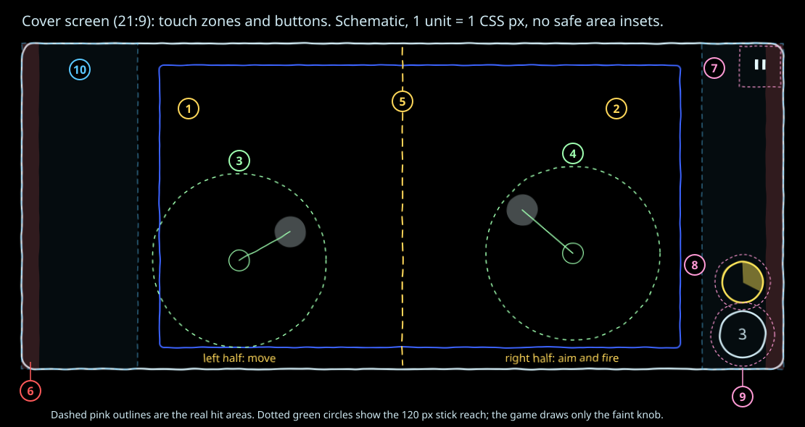

| # | Zone or button | What it does |
|---|---|---|
| 1 | Left half of the screen | The first finger down here becomes the move stick. |
| 2 | Right half of the screen | The first finger down here becomes the aim stick. Holding it past the dead zone fires. |
| 3 | Move stick | Appears where your thumb lands. Only a faint knob is drawn under your thumb. |
| 4 | Aim stick | Same as the move stick. The ship turns to face the aim direction. |
| 5 | Centre line | Splits move from aim. The split is the middle of the whole screen, HUD columns included. |
| 6 | Edge strips, 24 px each side | A touch that starts here is ignored, so the phone's back swipe does not grab a stick. |
| 7 | Pause (top right) | Opens the pause screen. Hit area 56 px square. |
| 8 | Super ring (right column) | Tap when full to fire your super. Hit circle 76 px across. |
| 9 | Bomb ring (right column, bottom) | Tap to bomb. Shows bombs left. Hit circle 88 px across. |
| 10 | HUD columns | Display only. Touches here still count as stick starts (left or right half). |

### Main screen (10:9)

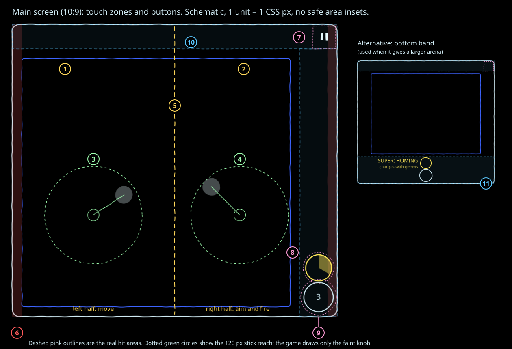

| # | Zone or button | What it does |
|---|---|---|
| 1 | Left half | Move stick starts here. |
| 2 | Right half | Aim stick starts here. |
| 3 | Move stick | Floating, faint knob only. |
| 4 | Aim stick | Floating, fires past the dead zone. |
| 5 | Centre line | Middle of the whole screen. |
| 6 | Edge strips, 24 px | Starts here are ignored. |
| 7 | Pause (top right) | Opens the pause screen. Hit area 56 px. |
| 8 | Super ring | Right column, above the bomb. Hit circle 76 px. |
| 9 | Bomb ring | Right column, bottom. Hit circle 88 px. |
| 10 | Top band, 60 px | Score and status text. Display only. |
| 11 | Bottom band layout | Some arenas fit better with the buttons at the bottom. Then the super and bomb rings sit at bottom centre with the super label to their left. The game picks whichever layout gives the bigger arena. |

### Stick behaviour

| Property | Value |
|---|---|
| Origin | Wherever your thumb first touches. Not a fixed spot. |
| Reach | 120 CSS px from the origin. Moving further does nothing more. |
| Dead zone | 12 percent of the reach (14.4 px), on both sticks. Inside it the stick reads zero: no movement, no fire. |
| Response | Linear. Past the dead zone the output rises evenly from 0 to full at 120 px. |
| Move speed | Full deflection is 420 u/s. Half deflection is half speed. With space physics on, see section 4. |
| Aim | Past the dead zone the aim angle is the stick angle and the ship fires. |
| Visual | A small filled knob (21.6 px radius, 30 percent alpha) under each thumb. No ring. It vanishes when you lift. |
| Extra fingers | One finger per stick. A second finger in the same half is ignored. |

### Buttons

- Buttons are checked before sticks, so a thumb that lands on a button never becomes a stick.
- Bomb and super hit circles overlap a little. The nearer centre wins.
- A press counts once. Hold it and nothing repeats. Lift and tap again for another press.
- Bomb: fires if you have a bomb, you are alive, and 1.0 s has passed since the last bomb.
- Super: fires only when the ring is full and you are alive.

### Pause, fold and landscape

- The pause button, the phone's back gesture (first press) and switching away from the app all pause the game.
- Folding or unfolding mid game pauses it. The HUD and buttons move to the new layout. A stick whose start point is now off screen is dropped. Tap Resume when ready.
- A fold can drop fullscreen. Your next tap asks for fullscreen again.
- The game asks for landscape. If the phone refuses, it still plays in portrait.
- The pause screen has Resume, Restart, Settings and Quit.

## 3. Core loop and scoring

**Kill an enemy, it drops geoms, geoms raise the multiplier, so later kills score more.**

### HUD on the cover screen

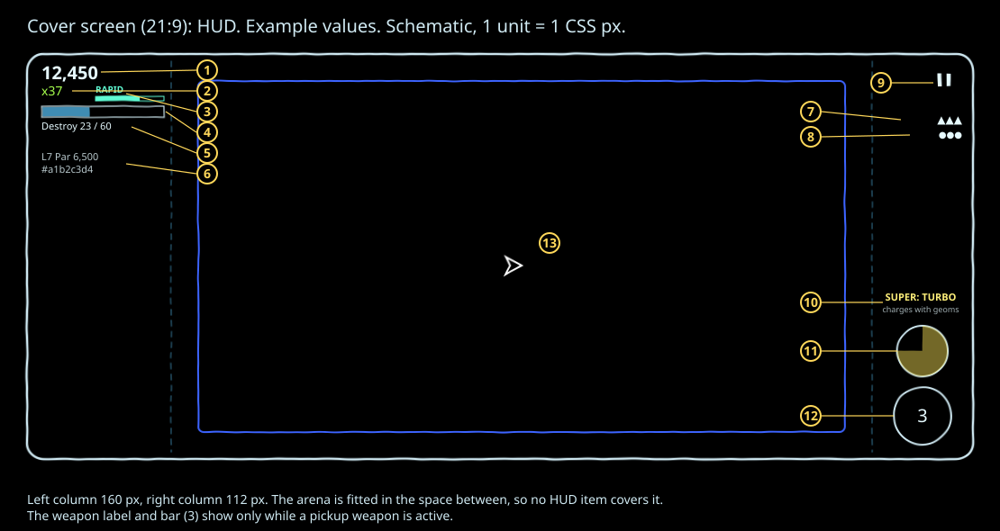

| # | Item | Meaning |
|---|---|---|
| 1 | Score | Points this level, with thousands separators. |
| 2 | Multiplier | Lime green "x" number. Starts at x1. |
| 3 | Weapon (v2) | Pickup weapon name and a bar that drains over 20 s. Hidden while you have the default spread. |
| 4 | Objective bar | Fills toward the objective. |
| 5 | Objective label | For example "Destroy 23 / 60", "Survive 1:12", "4,200 / 5,000  0:45", then "Target met  0:20". Endless shows "Endless". |
| 6 | Level line | Level number, par and level hash, for example "L7  Par 6,500  #a1b2c3d4". Endless shows "Endless  Seed N  m:ss". |
| 7 | Lives | One ▲ per life, up to 5, then "▲ x N". |
| 8 | Bombs | One ● per bomb, up to 5, then "● x N". |
| 9 | Pause | Two bars. |
| 10 | Super label and hint | "SUPER: HOMING", "SUPER: DETONATE" or "SUPER: TURBO", then "charges with geoms" or "ready: tap ring". |
| 11 | Super ring | Fills clockwise in yellow as you collect geoms. |
| 12 | Bomb ring | Number of bombs left. |
| 13 | Arena | Always fully visible between the HUD columns. |

### HUD on the main screen

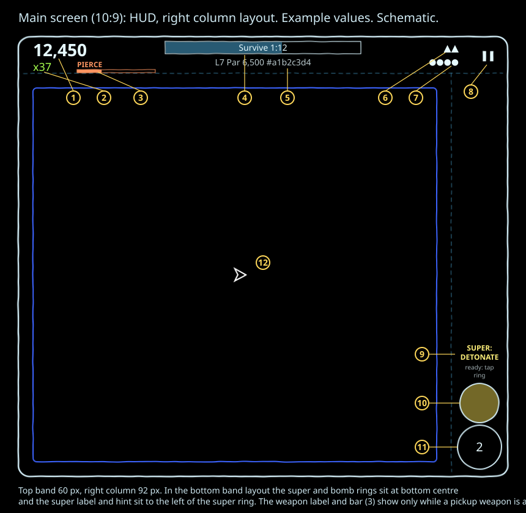

| # | Item | Meaning |
|---|---|---|
| 1 | Score | Top left. |
| 2 | Multiplier | Under the score. |
| 3 | Weapon (v2) | Right of the multiplier, with its countdown bar. |
| 4 | Objective | Bar and label, top centre. |
| 5 | Level line | Under the objective. |
| 6 | Lives | Top right. |
| 7 | Bombs | Under lives. |
| 8 | Pause | Top right corner. |
| 9 | Super label and hint | Wrapped over two lines above the super ring. |
| 10 | Super ring | Fills clockwise. |
| 11 | Bomb ring | Bombs left. |
| 12 | Arena | Below the top band, left of the column. |

### Where points come from

Points for a kill are the enemy's base value times your multiplier at that moment. The geoms from that kill do not count for that kill.

| Source | Base value | Geoms dropped |
|---|---|---|
| Wanderer | 10 | 1 |
| Pinwheel | 25 | 1 |
| Dart | 30 | 1 |
| Grunt | 50 | 1 |
| Swirl (v2) | 80 | 1 |
| Weaver | 100 | 2 |
| Charger (v2) | 120 | 2 |
| Blink (v2) | 130 | 2 |
| Splime (v2) | 140 | 2 |
| Bulwark (v2) | 150 | 3 |
| Spawner | 150 | 3 |
| Sower (v2) | 180 | 3 |
| Snake head | 200 | 4 |
| Gravity well, shot down | 250 | 5 |
| Snake body, Mine (v2), Slime (v2) | 0 | 0 |

These kills score: your bullets, drone shots, the Ram drone, orbit blades and the Detonate super. These remove enemies with no points and no geoms: bombs, your death, a gravity well eating an enemy, and a gravity well exploding.

### The multiplier

- Starts at x1 each level.
- Plus 1 per geom collected. Cap x999.
- Goes back to x1 only when you die. Nothing else lowers it.
- Geoms last 4 s. They pull toward you from 90 u away at 600 u/s and are collected within 28 u.
- When you die every geom on the field vanishes.

### Worked examples

| Moment | Multiplier | Kill | Points |
|---|---|---|---|
| Level start | x1 | Grunt | 50 x 1 = 50 |
| After 20 geoms | x21 | Weaver | 100 x 21 = 2,100 |
| After 49 more geoms | x70 | Snake head | 200 x 70 = 14,000, then its 4 geoms take you to x74 |
| Later, at x100 | x100 | Gravity well shot down | 250 x 100 = 25,000, then its 5 geoms take you to x105 |
| At the cap | x999 | Sower | 180 x 999 = 179,820 |
| Just after a death | x1 | Grunt | 50 again |

The lesson: early on, collecting geoms matters more than killing fast. One death wipes the multiplier you built.

### Par and stars

- Each Adventure level has a par score: at least 1,000 and always a multiple of 500.
- Stars: ★ at par, ★★ at 2 x par, ★★★ at 4 x par. For par 6,500 that is 6,500, 13,000 and 26,000.
- Stars are given only when you complete the objective. A failed level gives 0 stars.
- The intro card shows par and all three thresholds before the level starts.
- Your best score and best stars per level are kept separately: a later run can raise either.

## 4. Your ship

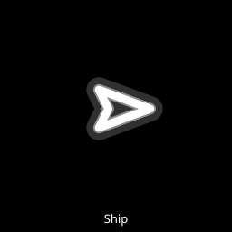

| Property | Value |
|---|---|
| Shape | White arrowhead. The nose points where you aim, or where you move when not aiming |
| Hitbox | Radius 10 u |
| Top speed | 420 u/s (space physics Off and Low) |
| Lives | 3 per Adventure level. Endless: 3 at start, see section 9 |
| Respawn | 1.5 s after death, at the arena centre |
| Invulnerability | 2.0 s after spawning and after each respawn. The visual cue for it is unknown (see the note below) |
| Walls | You slide along walls and obstacles. No bounce, no damage |

When you die:
- Lives drop by 1 and the multiplier goes to x1.
- Every enemy, segment, Mine and Slime is removed with no score. Gravity wells, Spawners and a weapon pickup on the floor stay.
- All geoms vanish. Your weapon goes back to spread. Your drone disappears until you respawn.
- The phone vibrates once for 60 ms.
- The wave clock stops until you are back, so you do not miss spawns or lose objective time.
- Bombs are not refunded. Super charge is kept.

Note: the game gives you 2.0 s of invulnerability, but no blink or flash for it could be found in the drawing code. Treat the first 2 s after a respawn as safe, but do not expect a visual cue.

### Space physics (v2)

Settings has a Space physics row: Off, Low, Medium, High. Default Off.

- **Off.** Your speed follows the stick exactly and instantly. This is the original game.
- **Low, Medium, High.** The stick is a thruster. The longer you hold it, the harder you accelerate, up to a ceiling. Let go and you drift, slowing under drag, and stop dead below 3 u/s. Pushing against your drift brakes harder. Walls still slide, no bounce.

| Level | Start push (u/s²) | Push ceiling (u/s²) | Push growth time (s) | Top speed (u/s) | Drag when released (per s) | Brake boost |
|---|---|---|---|---|---|---|
| Off | instant | instant | none | 420 | none, stops at once | none |
| Low | 1200 | 2400 | 0.6 | 420 | 4 | x2.5 |
| Medium | 800 | 2000 | 0.8 | 460 | 2.5 | x2.0 |
| High | 500 | 1800 | 1.0 | 520 | 1.2 | x1.6 |

What that feels like (figures computed from the table, not measured):

| Level | Rest to top speed | Glide after letting go at top speed | Time to slow to 10 percent | Feel |
|---|---|---|---|---|
| Low | 0.28 s | 105 u | 0.58 s | Almost Off. A short slide when you let go. |
| Medium | 0.43 s | 184 u | 0.92 s | A clear glide. Plan your stops. |
| High | 0.71 s | 433 u | 1.92 s | Floaty. A long coast, about half an arena height. Fastest top speed. |

More rules:
- Hold time only resets when you lift your thumb. Changing direction does not reset it.
- Half deflection gives half push, but the top speed stays the same.
- Respawning zeroes your speed.
- You can change the setting from the pause screen. It takes effect on the next step.
- Slime halves your top speed under any setting (section 8).

## 5. Weapons

You always start a level with spread. Kills drop weapon pickups (v2) that swap your weapon for 20 s.

### Spread (default)

| Property | Value |
|---|---|
| Pattern | 3 bullets at minus 6, 0 and plus 6 degrees from your aim |
| Rate | 12 volleys a second |
| Bullet | 1400 u/s plus your speed along the aim, capped at 1600. Radius 4 u. Life 1.2 s |
| Damage | 1 per bullet. A bullet stops on the first thing it hits |

### Pickup weapons (v2)

| Image | Weapon | How it fires | Rate | Bullet |
|---|---|---|---|---|
| 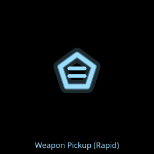 | Rapid | 2 parallel bullets, 5 u either side of your aim line | 26 volleys a second | 1500 u/s plus your speed, cap 1600. Radius 3 u. Life 1.0 s. Stops on first hit |
| 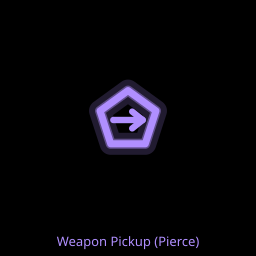 | Pierce | 1 heavy bullet | 8 a second | 1600 u/s. Radius 6 u. Life 1.0 s. Hits up to 4 different enemies (the first plus 3 more) |
| 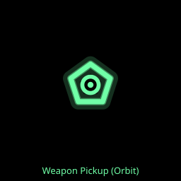 | Orbit | 4 blades circle you at 80 u, 2.4 turns a second, plus 1 forward bullet while aiming | Forward bullet 6 a second | Blade radius 7 u. Each blade does 1 damage, then rests 0.12 s. Blades are never used up |

Pierce bullets are stopped by walls, Snake body segments, gravity well cores and a Bulwark shield. Orbit blades pass through Snake body segments, can damage a gravity well, and are absorbed by a Bulwark shield (the blade rests with no damage).

All bullets except orbit blades are pulled by gravity wells. Bullets vanish on walls and obstacles.

### Pickups (v2)

| Rule | Value |
|---|---|
| Look | 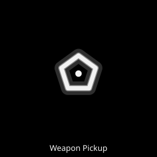 A spinning five sided outline with a weapon mark: two bars (rapid, pale ice blue), an arrow (pierce, pale violet), a ring round a dot (orbit, mint) |
| When | Counted on scoring kills. The first is due at kill 15, then every 25 (40, 65, 90 and so on). The count restarts each level |
| Where | At the position of the kill that made it due |
| How many | One at a time. If one is already on the floor, the next waits for the first kill after it is gone |
| Life | 8 s on the floor. Blinks in the last 2 s |
| Pick up | Fly within 28 u of it |
| Duration | 20 s. The HUD bar drains over that time |
| Same again | Picking up the weapon you hold refills it to 20 s |
| Different | Replaces your current weapon |
| On death | You go back to spread. A pickup lying on the floor stays |
| Bombs | Leave the pickup alone. The end of a level removes it |

Which weapons can drop depends on the level band: levels 1 to 5 drop rapid only, levels 6 to 15 drop rapid or pierce, level 16 and up and Endless drop all three. The same weapon never drops twice in a row when there is a choice. The choice comes from the level seed, so a replay of a level drops the same weapons in the same order.

The HUD label colours differ from the pickup colours: the label reads RAPID in teal, PIERCE in orange and ORBIT in violet.

### Settings toggle

Settings, Weapon pickups: On (default) or Off. Off means no pickups drop and the kill count does not run. Turning it off mid level cancels a waiting drop. A weapon you already hold runs out normally.

## 6. Bombs, drones and supers

### Bombs

| Rule | Value |
|---|---|
| Stock | 3 per Adventure level. Endless: 3 at start, plus 1 every 150,000 points, at most 9 |
| Cooldown | 1.0 s between bombs |
| Effect | Removes every enemy, every spawning enemy, every Snake segment, every Mine, every Spawner and every Slime puddle. Gravity wells are not destroyed: they go back to their starting size, mass and health |
| Score | None for anything removed, and no geoms. Geoms already on the floor stay |
| Not affected | Weapon pickups. The Bulwark shield does not stop a bomb |
| On death | Not refunded |

Tips: a bomb is a life saver, not a score tool. Use it the moment you are boxed in. A bomb also deflates a fat gravity well before it explodes.

### Drones

One drone per level, shown on the intro card. Drones cannot be hurt, are not pulled by wells and vanish while you are dead.

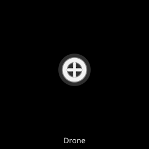

| Drone | Behaviour | Numbers |
|---|---|---|
| Attack | Circles you and shoots the nearest enemy | Circle radius 60 u at 1.5 turns a second. Range 450 u. 4 shots a second, normal bullets, 1 damage |
| Collect | Sits behind your nose and vacuums geoms | 50 u behind you. Pulls geoms within 260 u at 900 u/s. Collects within 28 u of the drone |
| Ram | Circles you, then charges the nearest enemy | Range 400 u. Charge 700 u/s. 2 damage on contact, then 1.2 s rest and a return at 900 u/s |

The drone is a small white circle with a cross. Drones never target Snake body segments or gravity wells. The Ram drone ignores the Bulwark shield.

Which drone you get: levels 1 to 5 always Attack. Levels 6 to 15: Attack 50, Collect 30, Ram 20 (weights). Level 16 and up: about a third each. Endless: always Attack.

### Supers

One super type per level, named on the intro card and on the super label.

| Rule | Value |
|---|---|
| Charge | 1 per geom collected, full at 60 |
| Use | Tap the super ring when full. Charge empties and refills from new geoms, so you can use it more than once |
| On death | Charge is kept. You cannot fire it while dead |

| Super | Effect | Numbers |
|---|---|---|
| Homing | Every bullet on screen, and every bullet you fire in the window, turns toward the nearest enemy. Homing bullets turn hot pink | 5.0 s window. Seeks within 300 u. Turns up to 540 degrees a second. Bullets keep homing until they expire. Ignores Snake body segments and gravity wells |
| Detonate | Your drone explodes and kills every enemy within 260 u of it, for full score and geoms | Snake heads die and their segments go with them. Gravity wells are not hurt. The drone is gone for 3.0 s, then returns. Needs the drone to be present |
| Turbo | Doubles the fire rate of whatever weapon you hold | 5.0 s. Spread goes to 24 volleys a second. Orbit blades keep their speed |

Which super you get: levels 1 to 5 Homing 34 or Turbo 66 (weights). Level 6 and up: about a third each. Endless: always Turbo.

Tips: Detonate is best when you fly into a crowd with the drone close. Homing steers every bullet, so more bullets means more homing hits: rapid fires 52 bullets a second, spread 36. Turbo doubles those: spread to 72 a second, rapid to 104.

## 7. Enemies

### Rules for every enemy

- **Telegraph.** Every wave enemy appears as a flashing outline at half brightness for 0.6 s before it is live. During that time it cannot hurt you and cannot be hit. Darts from a Spawner telegraph for 0.4 s.
- **Contact kills.** Touching any live enemy kills you unless you are invulnerable.
- **Walls.** Enemies slide along walls. Wanderers and Pinwheels bounce instead.
- **Crowding.** Enemies of the same kind push gently apart, so they do not stack into one blob.
- **Speed.** Enemy speed rises with the level: x1.00 for levels 1 to 5, x1.05 for 6 to 15, x1.10 for 16 to 30, x1.20 at 31 rising 0.005 a level to x1.40 at level 71. Small arenas slow enemies a little (down to x0.88 on the smallest), so the cover screen stays fair.
- **Safe spawns.** A fixed spawn point within 180 u of you is mirrored to the other side of the arena. Ring spawns appear 260 to 340 u from you.
- **Cap.** Each level has a maximum number of live enemies: 60 in levels 1 to 5, 90 in 6 to 15, 120 in 16 to 30, 160 from 31. Extra spawns wait in a queue.

Bands: levels 1 to 5 are band 1, 6 to 15 band 2, 16 to 30 band 3, 31 and up band 4. "Weight" below is the share used to pick each level's roster (3 to 6 kinds, Grunt always included).

### Tier 1: v1 basics, from level 1

Levels 1 to 5 always have exactly Grunt, Wanderer and Pinwheel.

#### Grunt

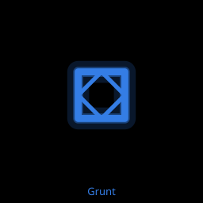

| Field | Detail |
|---|---|
| Colour and shape | Blue square with a diamond inside, "the box" |
| Size | Radius 14 u |
| Behaviour | Flies straight at you at 150 u/s. 1 HP |
| Tells | Pulses in size twice a second (looks only, the hitbox does not change). Always heads straight for you |
| Threat | Low alone, high in a crowd |
| Counter | Back away while firing. Any weapon kills it in one hit |
| Score and geoms | 50, 1 geom |
| First appears | Level 1. In every roster. Weight 40, 30, 25, 20 by band |
| Notes | The most common enemy. Its music motif is a steady low pulse |

#### Wanderer

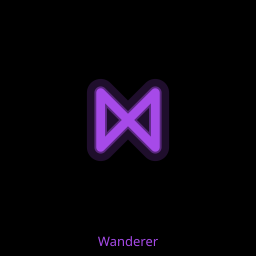

| Field | Detail |
|---|---|
| Colour and shape | Purple crossed bow tie, "the bow tie" |
| Size | Radius 13 u |
| Behaviour | Drifts in a straight line at 110 u/s and bounces off walls. Ignores you. Spins half a turn a second. 1 HP |
| Tells | Its path is a straight line until it hits a wall |
| Threat | Low. It only kills you if you fly into it |
| Counter | Shoot it when convenient. Watch the bounce angle near walls |
| Score and geoms | 10, 1 geom |
| First appears | Level 1. Weight 35, 20, 12, 8 by band |
| Notes | Cheap points, but every geom counts for the multiplier |

#### Pinwheel

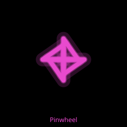

| Field | Detail |
|---|---|
| Colour and shape | Magenta four blade pinwheel |
| Size | Radius 20 u, a big target |
| Behaviour | Drifts slowly at 60 u/s and bounces off walls. Spins a quarter turn a second. 2 HP |
| Tells | Slow straight drift |
| Threat | Low, but its size blocks lanes |
| Counter | Two hits. Easy to hit from range |
| Score and geoms | 25, 1 geom |
| First appears | Level 1. Weight 25, 15, 10, 8 by band |
| Notes | The large hitbox makes it an easy geom source when the arena is quiet |

### Tier 2: v1 advanced, from level 6

#### Weaver

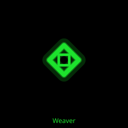

| Field | Detail |
|---|---|
| Colour and shape | Green diamond with a small square inside, "the dodger" |
| Size | Radius 14 u |
| Behaviour | Seeks you at 190 u/s. When any bullet within 140 u is heading at it, it sidesteps away from the bullet's line at 320 u/s for 0.25 s, then cannot dodge for 0.4 s. 1 HP |
| Tells | A sudden sideways jink means it just used its dodge |
| Threat | Medium. Fast and hard to hit head on |
| Counter | Fire, let it dodge, then fire again within 0.4 s. A wide spread or rapid stream catches the sidestep. Homing bullets turn after it |
| Score and geoms | 100, 2 geoms |
| First appears | Level 6. Weight 0, 20, 20, 18 by band |
| Notes | It dodges drone shots too |

#### Dart

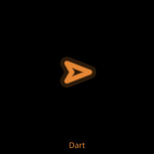

| Field | Detail |
|---|---|
| Colour and shape | Orange thin arrowhead |
| Size | Radius 9 u, the smallest enemy |
| Behaviour | Homes on you at 260 u/s but turns at most 140 degrees a second. Comes in clusters of 5 to 8. 1 HP |
| Tells | Clusters appear together. Their nose shows where they are turning |
| Threat | Medium. Fast, but cannot turn sharply |
| Counter | Strafe across their path: a sharp sidestep at the last moment makes them overshoot. Spread clears a cluster |
| Score and geoms | 30, 1 geom |
| First appears | Level 6. Weight 0, 15, 18, 20 by band. Spawners also emit them from level 16 |
| Notes | Fast high runs in the music mark their presence |

#### Snake

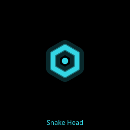 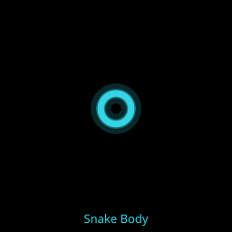

| Field | Detail |
|---|---|
| Colour and shape | Cyan hexagon head with a dot, trailing 12 cyan circles |
| Size | Head radius 13 u. Body segments radius 9 u, 18 u apart |
| Behaviour | The head seeks you at 170 u/s, turning at most 120 degrees a second, with a side to side weave. Only the head can be hurt: 6 HP. Body segments block bullets and kill you on contact |
| Tells | The weave swings 40 degrees either side, 1.2 times a second |
| Threat | High. The body is a moving wall |
| Counter | Get in front of the head and fire at it. Orbit blades pass through the body and hit the head. Killing the head destroys the whole body |
| Score and geoms | Head 200 and 4 geoms. Body segments 0 |
| First appears | Level 16. Weight 0, 0, 15, 16 by band. At most 2 new snakes per 30 s of schedule in band 3, 3 in band 4 |
| Notes | Gravity wells do not pull snakes. A snake kill makes the big kill sound and a chord in the music |

#### Spawner

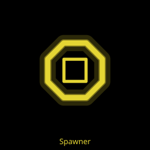

| Field | Detail |
|---|---|
| Colour and shape | Yellow octagon with a square inside |
| Size | Radius 24 u |
| Behaviour | Placed by the level. Appears 20 to 40 s in (band 3) or 10 to 30 s in (band 4). Creeps toward you at 50 u/s. 2.0 s after it appears it emits 5 Darts in a ring around itself, then again every 6.0 s (band 3) or 5.0 s (band 4). It skips an emit while 16 of its Darts are alive. 12 HP |
| Tells | Its Darts flash on a small ring around it for 0.4 s before they launch |
| Threat | High if ignored |
| Counter | Kill it early. Focus fire: it takes 12 hits. A bomb destroys it |
| Score and geoms | 150, 3 geoms |
| First appears | Level 16: 0 to 1 per level in band 3, 1 to 2 in band 4. Never in Endless |
| Notes | Survives your death. Not pulled by wells |

### Tier 3: v2 advanced enemies (v2)

The level generator swaps some groups for these kinds: 1 new kind per roster in band 2, 2 in band 3, 3 in band 4. Band 1 never has them. "Share" is the target share of each band's enemy groups.

#### Charger (v2)

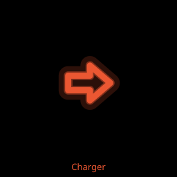

| Field | Detail |
|---|---|
| Colour and shape | Vermilion (red orange) heavy arrow |
| Size | Radius 15 u |
| Behaviour | Repeats a 2.7 s cycle: winds up for 1.0 s while turning toward you at up to 120 degrees a second, dashes 0.5 s straight ahead at 720 u/s, rests 1.2 s. A wall ends the dash. 2 HP |
| Tells | During the wind up it draws a lane ahead of it, 600 u long and as wide as its body, with chevrons. The lane brightens through the wind up and flickers in the last 0.2 s before the dash. A streak trails the dash |
| Threat | High. The fastest thing in the game |
| Counter | Step sideways out of the lane before it flickers. It cannot steer once dashing. Shoot it during the 1.2 s rest |
| Score and geoms | 120, 2 geoms |
| First appears | Level 6. Share 12, 16, 18 in bands 2 to 4 |
| Notes | Not pulled by wells while dashing. Its music motif is a rising wind up, then silence |

#### Bulwark (v2)

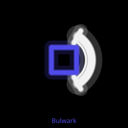

| Field | Detail |
|---|---|
| Colour and shape | Indigo square behind a white curved shield |
| Size | Body radius 18 u. Shield arc at 26 u, 60 degrees either side of its heading |
| Behaviour | Moves forward at 90 u/s and turns toward you at only 70 degrees a second. 3 HP |
| Tells | The white shield shows the blocking side. End ticks mark where the open flank begins. A blocked shot makes a bright arc and sparks on the shield (Standard and High effects) and a metallic ping |
| Threat | Medium. Slow, but it soaks your fire |
| Counter | Circle it and shoot the sides or rear. It turns slowly, so keep moving round it. Bombs, Detonate and the Ram drone ignore the shield |
| Score and geoms | 150, 3 geoms |
| First appears | Level 16. Share 12 in band 3, 16 in band 4 |
| Notes | The shield blocks your bullets, pierce bullets, drone shots and orbit blades |

#### Blink (v2)

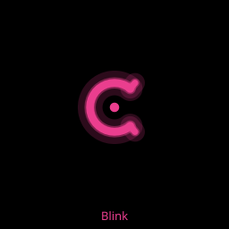

| Field | Detail |
|---|---|
| Colour and shape | Rose broken ring with a bright centre dot. The gap faces where it is heading |
| Size | Radius 13 u |
| Behaviour | Drifts toward you at 100 u/s for 2.2 s, then warps for 0.4 s, then jumps to a point 180 to 260 u from you. If you are moving faster than 40 u/s the landing point is ahead of you along your path. 1 HP |
| Tells | During the warp a ghost fades at the old spot and a ring closes onto the landing spot. A flash and a streak mark the arrival |
| Threat | Medium to high. It lands where you are going |
| Counter | When the ring appears, change direction or stop. It is harmless and cannot be hit during the warp; shoot it right after it lands |
| Score and geoms | 130, 2 geoms |
| First appears | Level 16. Share 10 in band 3, 14 in band 4 |
| Notes | Landing spots are kept inside the arena |

#### Swirl (v2)

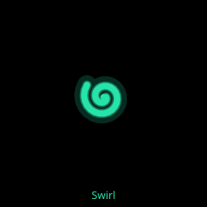

| Field | Detail |
|---|---|
| Colour and shape | Jade open spiral with a centre dot |
| Size | Radius 12 u |
| Behaviour | Spirals in from afar at 144 u/s, then circles you at 240 u while closing 20 u/s. Within 90 u it dives straight at the spot you were in, at 300 u/s, for up to 1.5 s. A wall or the time limit ends the dive and it circles again. 1 HP |
| Tells | It circles before it strikes. The dive is a straight line |
| Threat | Medium |
| Counter | Shoot it while it circles. If it gets close, sidestep across the dive line |
| Score and geoms | 80, 1 geom |
| First appears | Level 6. Share 10, 12, 12 in bands 2 to 4 |
| Notes | Each Swirl circles one way, clockwise or anticlockwise, fixed for its life |

#### Sower and Mine (v2)

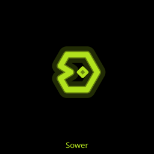 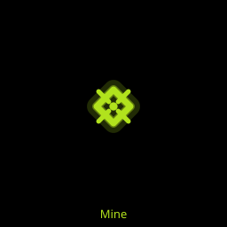

| Field | Detail |
|---|---|
| Colour and shape | Sower: chartreuse (yellow green) hexagon with a notch cut in its tail. Mine: small chartreuse diamond with spikes |
| Size | Sower radius 16 u. Mine radius 9 u |
| Behaviour | The Sower heads for the nearest wall, then runs along it clockwise at 70 u/s and drops a Mine every 3.0 s. 4 HP. Mines do not move. A Mine is harmless for 0.8 s after it drops, then kills on contact. It lasts 12 s. 1 HP |
| Tells | Mines are dim until armed, then solid, then blink in their last 2 s |
| Threat | Medium. Over time the walls fill with Mines |
| Counter | Stay off the walls near a Sower and kill it early. Shoot Mines from range; they pop in one hit |
| Score and geoms | Sower 180 and 3 geoms. Mine 0 and 0, and it is not a kill |
| First appears | Level 31. Share 10 in band 4 |
| Notes | At most 6 live Mines per Sower and 24 in total. Mines are not pulled by wells. Drones and Homing do target Mines |

#### Splime and Slime (v2)

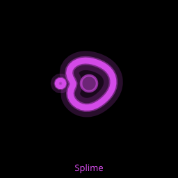 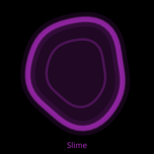

| Field | Detail |
|---|---|
| Colour and shape | Splime: orchid round blob with a drip at the back. Slime: a soft, dark orchid, see through puddle |
| Size | Splime radius 16 u. Slime radius 40 u |
| Behaviour | The Splime walks straight at you at 147 u/s (0.35 of your speed) and drops a Slime puddle every 2 s. 3 HP. Slime is harmless but slows you (section 8). It lasts 8 s |
| Tells | 0.6 s before a drop the Splime swells to 1.25 times its size and a ring grows round it to the puddle size, showing where the Slime will land. A new puddle grows from half to full size in 0.3 s and blinks softly in its last 2 s |
| Threat | Medium. The Splime itself kills on contact; the Slime makes everything else harder to dodge |
| Counter | You are much faster: kite it and kill it in 3 hits. Steer around puddles. A bomb clears all Slime |
| Score and geoms | Splime 140 and 2 geoms. Slime 0 and 0, never a kill |
| First appears | Level 6. Share 8, 10, 10 in bands 2 to 4 |
| Notes | At most 3 puddles per Splime and 12 in total. Bullets, drones and blades pass through Slime. Wells do not pull it |

### Hazard: gravity well

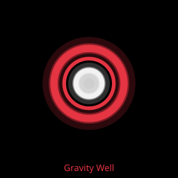

| Field | Detail |
|---|---|
| Colour and shape | Red ring around a white filled core |
| Size | Radius 24 u, plus 2 u for each enemy it has eaten |
| Behaviour | Fixed in place from the start of the level. Pulls you, your bullets and most enemies within 320 u. Eats enemies whose centre enters it. At 20 meals it explodes. 40 HP, plus 2 per meal |
| Tells | It grows as it eats. A big well is close to exploding |
| Threat | High. Touching the core kills you. The explosion kills every enemy within 220 u (no score) and you too unless invulnerable |
| Counter | Keep moving away: even at the core you still make at least 260 u/s directly away with physics Off. Shoot it down for big points. A bomb resets it to its starting size and health |
| Score and geoms | Shot down: 250 and 5 geoms. Exploding or bombed: nothing |
| First appears | Band 2: 0 to 1 per level. Band 3: 1 to 2. Band 4: 1 to 3. Never in Endless |
| Notes | Pull on you: 160 u/s at the core, fading to 0 at the rim. The pull stops within about 0.1 s of leaving the 320 u radius. It does not pull Snakes, Spawners, Mines, Slime, drones, geoms, orbit blades or a dashing Charger. Survives your death and bombs |

### Pickups and geoms

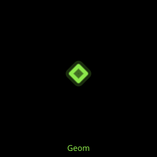 A geom: small lime green diamond, radius 6 u. See section 3. Weapon pickups: see section 5.

## 8. Hazards and arena

### Arena shapes and size

- The arena is always shown whole, centred, with no scrolling.
- Shapes: rectangle, rounded rectangle, circle, hexagon, and rectangle with wall obstacles.
- Size grows with the band. Height ranges: 700 to 760 u (band 1), 760 to 880 u (band 2), 860 to 1000 u (band 3), 940 to 1100 u (band 4). Width is 1.3 to 1.8 times the height.
- Obstacle walls are 24 u thick. None in band 1, 1 in band 2 (obstacle shape only), 1 to 2 in band 3, 1 to 3 in band 4.
- Endless always uses a 1600 by 1000 u rectangle with no obstacles.

### Walls

- You slide along walls and obstacles. They never hurt you.
- Bullets vanish when they hit a wall or obstacle.
- Wanderers and Pinwheels bounce. Other enemies slide.
- A wall ends a Charger dash and a Swirl dive early.
- A Sower runs along walls clockwise.

### Gravity wells

See the full entry at the end of section 7. In short: pull within 320 u, kill on contact, eat enemies, explode at 20 meals, shoot down for 250.

### Slime (v2)

- Touching Slime slows you to 50 percent for 2 s.
- The 2 s restarts every moment you stay on a puddle, so it lasts until 2 s after you leave.
- It does not stack: two puddles are still 50 percent.
- With space physics Off your speed is halved. With Low, Medium or High your top speed is halved.
- A bomb clears every puddle. Your death clears them too.

### Visual cues

These are looks only. They never change the game, but they tell you things.

| Cue | Meaning |
|---|---|
| Flashing half bright outline | An enemy is about to spawn there (0.6 s) |
| Grid ripples and bends (v2 lattice on Standard and High) | A kill, a death, a bomb or a super. Gravity wells pull a dimple into the grid. Moving faster than 120 u/s leaves a wake |
| Coloured ring through the grid | A kill, in that enemy's colour |
| Walls pulse (v2, Standard and High) | Faster and warmer as the threat rises. A slow breath means a quiet arena |
| Wall flash (v2, Standard and High) | A kill within 120 u of a wall |
| Throbbing field round the ship | A timed super (Homing or Turbo) is running |
| Low effects tier | The original static grid with a ripple. No trails, no wall pulse |

## 9. Modes

### Adventure

- An endless sequence of generated levels. The menu button reads "Adventure", or "Continue  L<n>" once you have unlocked more than level 1.
- Each level comes from your run seed plus the level number. Your run seed is made once on first launch and kept. Retry replays the identical level.
- Completing the objective unlocks the next level, whatever your stars.
- Level select shows unlocked levels in pages of 12, newest page first, each with its best stars.
- Each level: 3 lives, 3 bombs, one drone and one super, fixed by the level.

**Intro card.** Before each level a card shows the level number and your seed, the objective, par with the three star thresholds, and the drone and super names. It holds the game for 1.5 s. Tap to skip. Pausing freezes it.

**Objectives.**

| Objective | Win | Lose | Range by band (1 / 2 / 3 / 4) |
|---|---|---|---|
| Score in time | Your score is at or above the target when the timer runs out. The level always runs its full time, so you can keep climbing past par | Below target at time out, or out of lives | 60 / 75 to 90 / 90 to 105 / 105 to 120 s |
| Survive | The timer counts down to 0 with a life left | Out of lives | 45 to 60 / 60 to 90 / 75 to 105 / 90 to 120 s |
| Destroy | Kill the number of enemies shown. The level ends the moment you reach it | Out of lives | 30 to 50 / 60 to 100 / 100 to 150 / 150 to 220 kills |

- The score target is 80 percent of par rounded to 500, at least 1,000 and never above par. For par 6,500 the target is 5,000.
- Destroy counts every scoring kill of a real enemy: each Dart and Snake head counts 1. Snake segments, wells, Mines and Slime do not count. Bomb and death clears do not count.
- Objective weights: band 1 is 20 score, 40 survive, 40 destroy. Later bands are about a third each.
- Timers use the wave clock, which stops while you are dead.
- The first wave arrives 2.5 s in. The wave schedule loops its harder second half, so destroy levels never run out of enemies.

**Typed seed.** Settings has a seed box and "Play seed". It plays level 1 of any seed from 0 to 4294967295. This is a session only run: it does not unlock levels or record bests. The line under the box shows the level 1 hash. Level select always goes back to your own seed.

### Endless

- Fixed 1600 by 1000 u rectangle. No gravity wells, no Spawners. Attack drone and Turbo super, always.
- A fresh seed every game, shown on the results screen so the run can be reproduced.
- A 1.5 s "Ready" text, which you cannot skip, lets your thumbs settle.
- 3 lives and 3 bombs at start. Plus 1 life every 100,000 points and plus 1 bomb every 150,000 points, each capped at 9.
- The game ends when your last life is gone.

**The ramp.** Every 30 s of wave clock a new segment starts with its own roster and waves. Segment s plays like Adventure level 1 + 2s.

| Wave clock | Plays like | What changes |
|---|---|---|
| 0:00 | Level 1 | Grunt, Wanderer, Pinwheel |
| 1:30 | Level 7 (band 2) | Weaver, Dart and the first v2 kinds can appear. Speed x1.05 |
| 4:00 | Level 17 (band 3) | Snake, Bulwark and Blink can appear. Speed x1.10 |
| 7:30 | Level 31 (band 4) | Sower can appear. Speed x1.20. From here every segment adds one more spawn unit per wave, with no limit |
| 17:30 | Level 71 | Speed reaches its cap of x1.40 |

### Results screen

| Mode | Shows | Buttons |
|---|---|---|
| Adventure | "Level N complete" or "Level N failed", score, stars (★ earned, ☆ not), par, best (with "New best"), level hash | Next (only after a win), Retry, Menu |
| Endless | "Game over", score, "New high score" or "Top 10: #n" when it makes the table, best, the Endless seed | Retry, Menu |

The Endless table keeps your top 10 scores.

## 10. Strategy

### Beginner

1. **Keep your thumbs down.** The sticks float, so you never need to look for them. Lifting the right thumb stops fire.
2. **Back away while firing.** Grunts and Weavers fly straight at you. Moving away while shooting keeps them in your stream.
3. **Grab geoms.** Each one is plus 1 multiplier and they vanish after 4 s. Fly through the drops; they pull in from 90 u.
4. **Bomb early, not late.** You get 3 per level and they do not carry over. A bomb you die holding is wasted, and death costs your multiplier.
5. **Watch the flashing outlines.** An enemy goes live there in 0.6 s. Do not park on one.
6. **Use the 2 s after respawn.** You are invulnerable. Clear space and collect.

### Intermediate

1. **Protect the multiplier.** Only death resets it. A careful run that reaches x80 beats a reckless one that dies twice.
2. **Pick up weapons.** The first drops at kill 15, then every 25. A pickup lasts only 8 s on the floor.
3. **Match weapon to enemy.** Pierce hits up to 4 enemies in a line. Rapid's dense stream catches Weaver sidesteps. Orbit blades hit anything that comes within 80 u.
4. **Read the Charger lane.** Step out sideways, then punish the 1.2 s rest.
5. **Flank the Bulwark.** Its shield covers 120 degrees at the front and it turns only 70 degrees a second.
6. **Turn when a Blink ring appears.** It lands ahead of you if you keep moving straight.
7. **Make Darts overshoot.** They turn at most 140 degrees a second. A late sidestep beats them.
8. **Kill Spawners first.** It takes 12 hits, and it emits 5 Darts every 5 to 6 s until it dies.

### Advanced

1. **Shoot wells for 250 times your multiplier.** At x100 that is 25,000 plus 5 geoms. Bullets bend toward the well, so fire at the core from close in.
2. **Let wells eat, carefully.** A well removes enemies for free (no score), but at 20 meals it explodes across 220 u. A bomb deflates it.
3. **Save Detonate for a crowd.** It scores every kill within 260 u of the drone at your multiplier and drops all their geoms.
4. **Stack Turbo with a pickup.** Turbo doubles any weapon's rate: rapid goes to 52 volleys a second.
5. **Pace Endless.** The ramp turns hard at 7:30 (band 4) and keeps adding enemies every 30 s. Extra lives come every 100,000 points, so a high multiplier also buys lives.
6. **Score in time levels run the full clock.** Hitting the target early does not end the level. Keep scoring for stars.
7. **Space physics High for speed.** Top speed is 520 u/s, but you coast 433 u after letting go. Thrust against your drift to stop fast (brake boost x1.6).

## 11. Settings reference

Settings opens from the menu and from the pause screen. Opened from the menu it shows a live preview arena beside the panel.

| Setting | Range | Default | Effect | Notes |
|---|---|---|---|---|
| Neon | 0 to 100 slider | 70 | Glow and colour strength: bloom strength 0 to 2, bloom threshold 0.8 to 0.2, colour saturation 0.4 to 1.3, glow width 0 to 0.9, grid brightness 0.1 to 0.6 | Changes live while you drag. Saved when you lift your finger |
| Volume | 0 to 100 slider | 70 | Master volume for all sound | Music also passes through it |
| Music (v2) | 0 to 100 slider | 50 | Music level. 0 is off | Music never exceeds 35 percent of the master. Plays in levels only, never in menus |
| Space physics (v2) | Off, Low, Medium, High | Off | Ship movement model, section 4 | Takes effect on the next step |
| Weapon pickups (v2) | On, Off | On | Whether kills drop weapons, section 5 | |
| Effects (v2) | Low, Standard, High | Standard | Low: original static grid and ripple, no trails, no wall effects, no hit flashes, 2048 particles. Standard: deforming grid at 25 u spacing, trails, wall effects, dust, 2048 particles. High: finer grid at 16 u, denser bursts, 4096 particles | The main frame rate knob |
| Show FPS | On, Off | Off | Shows a frame rate readout | Use it to check the other settings |
| Glow | Bloom, Fallback | Bloom | Bloom uses a full screen glow pass. Fallback uses glow sprites instead | Neon works on both |
| Play seed | Run seed 0 to 4294967295 | empty | Plays level 1 of the typed seed, session only | Section 9 |
| Reset progress | Two taps within 3 s | none | Unlocked level back to 1 and Adventure bests cleared | Settings, the Endless top 10 and your run seed are kept |
| Build label | Five taps within 3 s | hidden | Shows a stress test button | A developer test. It starts a level |

**Frame rate advice.** On device, gate GD recorded (Ryan's paste, verbatim): "fps low 50/59, standard 59/59, high 59". Standard stayed the default because it held 59 fps on the main screen; High also held 59 but is opt in. The reason for the low tier reading of 50 is unknown. If the game stutters: turn Show FPS on, try Effects Standard or Low, then try Glow Fallback.

## 12. Music and sound

### Sound effects

| Sound | When |
|---|---|
| Short square blip | You fire (at most 12 a second) |
| Noise burst | An enemy dies, or a Mine pops |
| Deep crash | A big kill: Snake head, Spawner or gravity well |
| High chirp | A geom is collected (at most 20 a second) |
| Long rumble | A bomb or a Detonate |
| Falling saw and noise | You die |
| Rising tone | A level starts |

### Generative music (v2)

The music is built live from what is in the arena, so you can read the game by ear. It plays only during a level. It starts with the level and stops on quit or game over. Pause, switching apps and folding hold it, and it resumes on the next bar. The level seed shapes the melody line, so a level sounds the same each time.

**Base track.** A minor, 120 beats a minute, an 8 bar loop of Am, F, C, G (two bars each).

**Threat.** Every live enemy adds weight. Threat is the total divided by 40, capped at 1. Enemies still telegraphing do not count. The music follows a smoothed threat that rises over about 0.5 s and falls over about 3 s.

| Enemy | Weight | Enemy | Weight |
|---|---|---|---|
| Mine (v2) | 0.2 | Charger (v2) | 2 |
| Dart | 0.4 | Blink (v2) | 2 |
| Wanderer | 0.5 | Splime (v2) | 2 |
| Gravity well | 0.5 | Bulwark (v2) | 2.5 |
| Pinwheel | 0.8 | Snake head | 3 |
| Grunt | 1 | Sower (v2) | 3 |
| Spawner | 1 | Weaver | 1.5 |
| Swirl (v2) | 1.5 | Slime (v2), Snake body | 0 |

**What you hear as threat rises.**

| Threat | Layer that enters |
|---|---|
| 0 | Soft pad only, filter dark |
| 0.06 | Sub bass |
| 0.15 | Kick |
| 0.28 | Hi hat |
| 0.42 | Arpeggio |
| 0.7 and up | The lift: hi hat doubles to sixteenths, a backbeat clap joins, the arpeggio jumps an octave and the filter opens wide. It drops out again below 0.6 |

The filter opens from 450 Hz on an empty arena to 5.5 kHz at full threat, and further during the lift. A bright, busy mix means a crowded arena. For example, 10 Grunts is threat 0.25: pad, bass and kick, no hi hat yet.

**Enemy layers.** When a kind enters the arena you hear a short stinger on the next sixteenth note. Its motif joins on the next bar, fading in over one bar. It leaves 2 bars after the last one of that kind is gone. Hazards (wells, Spawners, Mines, Slime) have no layer.

| Enemy | Motif |
|---|---|
| Grunt | Steady quarter note pulse, low |
| Wanderer | Drifting random walk |
| Weaver | Off beat steps up and down |
| Pinwheel | Rotating four note bell cycle |
| Dart | Fast high runs |
| Snake | Long low sliding notes |
| Charger (v2) | Rising wind up, then silence |
| Bulwark (v2) | Heavy low pair, the lowest motif |
| Blink (v2) | Bright staccato pairs with gaps |
| Swirl (v2) | Looping spiral arpeggio |
| Sower (v2) | Sparse high ticks, the highest motif |
| Splime (v2) | Slow wobbling glide between two low notes |

**Kill notes (v2).** Each kind has its own kill note, placed on the beat grid. Not every kill sounds: 2 notes a bar when calm, up to 6 when crowded, at least an eighth note apart, and about 7 in 10 of the rest pass. Three kills in one beat, a big kill (Snake, Spawner, well) or a bomb plays one chord on the next beat instead.

**Hit sounds (v2).** A hit that does not kill plays a quiet tick an octave above that kind's kill note, at most 8 a second per kind. A shot blocked by a Bulwark shield plays a metallic ping, at most 4 a second. If you hear pings, you are hitting the shield: move to its side.

## 13. Install and device

- **Install.** Open the game's web address in Chrome on the Fold, wait about 10 s, then use the menu's "Add to Home screen" or "Install app". Launch it from the home screen icon. Full steps are in [docs/07-install-runbook.md](../07-install-runbook.md), section F.
- **Fullscreen.** The first screen says "Tap to start". That tap asks for fullscreen and landscape and turns on sound. A fold can drop fullscreen; the next tap asks again.
- **Offline.** After the first load the game is cached and runs with no connection. Updates install on the launch after they download.
- **Where progress lives.** Everything is stored on the phone, in the browser's storage for the game: your run seed, unlocked level, Adventure bests and stars, the Endless top 10 and every setting. Nothing is sent anywhere.
- **Resetting.** Settings, Reset progress (tap twice) sets the unlocked level to 1 and clears Adventure bests. To wipe everything, including settings and the Endless table, clear the site's data in the browser (runbook section I.3).

## 14. Glossary

| Term | Meaning |
|---|---|
| Arena unit (u) | The game's distance unit. The ship's hitbox radius is 10 u |
| Band | A level range: 1 to 5, 6 to 15, 16 to 30, 31 and up. Sets enemies, arena size and speed |
| Bomb | Clears the arena with no score. 3 per level |
| Cover screen | The Fold's outer 21:9 screen |
| Drone | Your helper: Attack, Collect or Ram |
| Geom | Lime green diamond dropped by kills. Plus 1 multiplier, plus 1 super charge |
| Hash | The 8 character code after "#" that identifies a level. Same seed and level, same hash |
| Lift | The music's high threat state |
| Main screen | The Fold's inner 10:9 screen |
| Motif | An enemy kind's two bar melody |
| Multiplier | Score factor, x1 to x999, reset by death |
| Par | A level's reference score. Stars at par, 2 x par, 4 x par |
| Pickup (v2) | A spinning pentagon that gives a weapon for 20 s |
| Roster | The enemy kinds a level can spawn, 3 to 6, always with Grunt |
| Run seed | The number your Adventure levels are built from |
| Segment | 30 s of Endless with its own roster and waves |
| Space physics (v2) | Optional thrust and drift movement |
| Stinger | The short note when an enemy kind first enters |
| Super | Homing, Detonate or Turbo. Charged by 60 geoms |
| Telegraph | The 0.6 s flashing outline before an enemy goes live |
| Threat | How dangerous the arena is right now, 0 to 1. Drives the music and the wall pulse |
| Wave clock | The level timer. It stops while you are dead |

## 15. Changelog

| Version or sha | Date | What changed in the game | What changed in the guide |
|---|---|---|---|
| v1.0.0 (4fbdaf7) | 2026-10-28 | First release: Adventure and Endless; Grunt, Wanderer, Weaver, Pinwheel, Dart, Snake, Spawner and gravity wells; three drones and three supers; neon slider and settings; results and high scores; installable and offline. Device gate G4 passed | No guide yet |
| v1.1.0 (e231b6d) | 2026-10-28 | Gravity well pull retuned (zero at the rim, up to 160 u/s at the core, fades fast on leaving). Main screen HUD bands measured so the arena is larger. Device gate G5 passed | No guide yet |
| 13b7d96 (v2 untagged) | 2026-10-29 | v2: space physics; weapon pickups (rapid, pierce, orbit); Charger, Bulwark, Blink, Swirl, Sower and Splime, plus Mine and Slime; deforming grid, trails, wall effects and effects tiers; generative music with enemy layers, kill notes, hit ticks and the shield deflect sound and spark | First edition |
